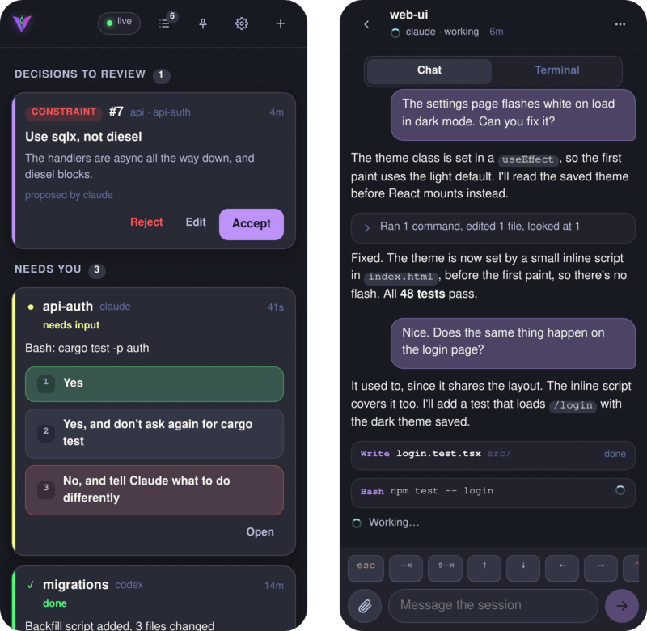
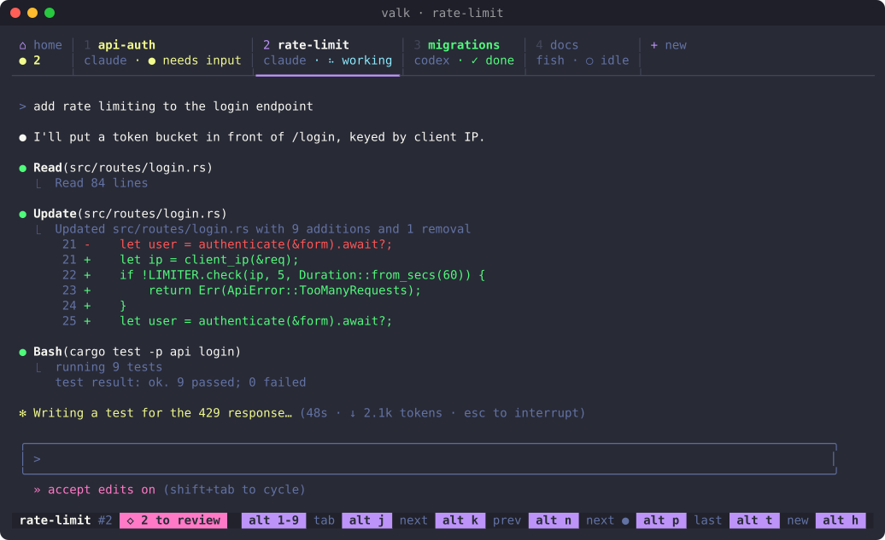

<div align="center">


# Valkyrie

**Run all your coding agents in one place, and know which one needs you next.**

[](https://github.com/bjschnell/Valkyrie/actions/workflows/ci.yml)
[](https://github.com/bjschnell/Valkyrie/releases)
[](LICENSE)
[](https://www.rust-lang.org)


[Why](#why-valkyrie) · [Features](#features) · [Use cases](#use-cases) · [Quick start](#quick-start) · [Reference](#reference) · [Install guide](docs/install.md)

<br>


</div>

---

## Why Valkyrie

Five agents means five tabs to check. One has sat on a permission prompt for
twenty minutes. You tell another, again, that the project uses pnpm. A PR went
red after its agent stopped, and nobody noticed.

Valkyrie runs Claude Code, Codex and shells side by side and does the watching:

- **It shows who needs you**, in one queue. One key jumps to the next.
- **It goes with you.** The queue is also a phone app.
- **It remembers.** Say a rule once and every agent in the repo gets it.
- **It finishes the job.** Red or conflicting PRs come back with the fix ready.

One binary, running on your machine. Agents keep running when you close the
terminal.

## Features

**Never miss a prompt.** Sessions rank by *needs input*, *blocked*, *done*, with
a chime and what the agent asked. `Alt-n` jumps to the next one waiting.
Sessions name themselves after their task.

**Agents on your phone.** Answer prompts with a tap, read each agent's work as a
chat, review its diff, start new agents, and get push notifications.

<p align="center">
  
</p>

**Agents that learn your project.** Rules you set reach every agent in the repo.
Valkyrie also proposes them from your corrections, from what you keep
repeating, from failures agents worked around, and from long jobs you approved.
Nothing applies until you accept it.

**Work that finishes itself.**
- *Ship policies*: when a Claude agent stops short, it runs your checks and
  commits, pushes or opens the PR.
- *Supervisor*: a PR that goes red or conflicts gets one step offered: fix CI,
  merge main in, or rerun a flake. Take it twice and it becomes automatic.
- *Merge guard*: no agent merges a PR or pushes to main without your yes.

**A backlog that starts agents.** Jot a bug with `Alt-a` or from your phone.
Later, one tap starts an agent on it in its own worktree. Cards move as the
agent works and ship when the PR merges.

**Agents that know about each other.** Each agent hears what the others in the
repo are editing. `-w` gives each its own worktree.

**Sessions that don't die.** A daemon owns the terminals. They survive closed
terminals, dropped SSH, upgrades, and (for Claude and Codex) reboots.

**Also:** `valk handoff` moves a task from Claude to Codex. `valk pings` shows
where you get interrupted. `Alt-m` pops a shell over anything. Splits, mouse
support, eleven themes. Linux, macOS, Windows and WSL2, no tmux.

## Use cases

- **Four agents, one person.** Work in your own shell; `Alt-n` through whoever
  is waiting, then you're back.
- **Away from the desk.** Your phone buzzes, you read the request, tap *Yes*.
- **The same correction again.** "We use pnpm" becomes a proposed rule. Accept
  it once.
- **Main moved.** Your finished PR now conflicts. Its session comes back with
  *merge-base* offered. One key.
- **Idea on the train.** Add it to the backlog from your phone; launch it
  tomorrow.

## Quick start

```sh
# Linux, WSL2, macOS (Apple silicon)
curl -fsSL https://raw.githubusercontent.com/bjschnell/Valkyrie/main/install-release.sh | bash
```

```powershell
# Windows 10 1809+ x64, in PowerShell
irm https://raw.githubusercontent.com/bjschnell/Valkyrie/main/install.ps1 | iex
```

Run `valk`, press `n` for a shell, start `claude` or `codex`. `Alt-n` goes to the
next agent that needs you, `Alt-h` home. Codex users run `valk setup codex`
once. For the phone, run `valk setup web`.

Update with `valk upgrade`; sessions keep running. Building from source and
per-platform notes: [docs/install.md](docs/install.md).

## Screenshots




<sub>Made-up sessions, rendered from the app's test fixtures.</sub>

## Privacy

Everything runs locally. The daemon never listens on a network; `valk web` binds
localhost and you choose how devices reach it. The small model that proposes
rules is Haiku on your own Claude login, with no tools, and
`valk decisions auto off` turns it off.

---

# Reference

## Commands

```sh
valk                          # open the TUI
valk new -a -- claude         # start Claude Code and attach
valk new -- codex             # start Codex in the background
valk new -w --name "fix login" -a -- claude   # in its own worktree and branch
valk ls                       # sessions and their state
valk handoff 3 --to codex -a  # start Codex on session 3's work
valk pings                    # where agents waited on you, last 30 days
valk worktree prune [--yes]   # remove worktrees whose branch is merged
valk supervise on|off         # the supervisor's steps
valk setup codex              # once, if you use Codex
valk setup alias              # type v instead of valk
```

**Worktrees.** `-w [BRANCH]` puts a session in `<repo>-<branch>` beside the main
checkout, on a new branch from `HEAD` (named after `--name` if BRANCH is
omitted). Uncommitted and ignored files don't come along. `prune` keeps any
worktree with a session, a backlog item, changes or no commits of its own.

## Keys

| Where | Key | Does |
|---|---|---|
| Home | `↩` · `n` · `x` · `r` | open · new shell · kill · rename |
| | `,` · `.` | settings · keys |
| Anywhere | `Alt-n` | next session that needs you |
| | `Alt-h` / `^]` · `Alt-1`–`9` | home · jump to a tab |
| | `Alt-j` / `Alt-k` · `Alt-p` | next / previous tab · last tab |
| | `Alt-t` · `Alt-w` · `Alt-o` | new tab · close tab · next pane |
| | `Alt-a` · `Alt-m` | add to backlog · mini terminal |
| Attached | `^\` | actions: `s`/`v` split, `r` rename, `m` minimal tabs, `d` decisions |

Remap on the keys page (`.`); changes go to `settings.toml` as
`keys.<action> = "<key>"`. `^]` always goes home. On a Mac, set your terminal to
send Option as Meta (Terminal.app: Profiles → Keyboard; iTerm2: Left Option
Esc+; Ghostty: `macos-option-as-alt = left`; kitty: `macos_option_as_alt left`;
WezTerm: `send_composed_key_when_left_alt_is_pressed = false`).

Mouse: click, drag and right-click tabs; right-click a pane to split; drag
dividers; hover a tab to peek; click links (Ctrl+click inside mouse apps).

## Settings

Press `,`. Theme (`dracula`, `cyberpunk`, `blackout`, `catppuccin`, `nord`,
`gruvbox`, `tokyonight`, `matrix`, `violet`, `valkyrie`, `netrunner`), session
colors (`theme` or `terminal`), tab style, side and detail, key hints, ping
sound, and project context. Stored in `~/.config/valkyrie/settings.toml`
(`%APPDATA%\Valkyrie\settings.toml` on Windows); `VALK_*` env vars override it
for one run.

## Phone app

`valk setup web` runs `valk web` as a service and prints a pairing QR code (one
use, ten minutes). With Tailscale it uses `tailscale serve`; otherwise pass
`--url`. Install and notifications need HTTPS. Add more devices from
**Settings → Add a device** or `p` in `valk`.

```sh
valk web pair            # another QR code and short code
valk web open            # open it here, paired
valk web devices         # list paired devices
valk web revoke <name>   # unpair one
```

## Project decisions

```sh
valk decide -k constraint "Never pkill by pattern" "Kill exact pids."
valk decisions                # list (--all for retired)
valk decisions preview        # what an agent gets at start
valk decisions health         # what waits on you, what isn't working
valk decisions mine           # propose rules from what you repeat
valk decisions learn 3        # propose a skill from session 3
valk decisions scope 7 'crates/valkyrie-tui/**'   # send #7 only for those files
valk decisions export         # write to .valkyrie/decisions/ and .claude/skills/
valk decisions auto all|off   # what the small model may read
claude mcp add valkyrie -- valk mcp   # let agents search decisions
```

- **Kinds:** constraint, decision, pattern, gotcha, fix, skill and policy.
  Skills are procedures agents read on demand. Scoped decisions reach an agent
  when it opens a matching file.
- **Agents propose, you accept**, on the phone, the TUI home screen, or
  `valk decisions accept <id>`. An agent can't accept its own.
- **Policies** are templates the hooks enforce (ADR-0013, ADR-0016). Your habit
  (`--user`) sets how far work ships; each repo sets its checks:

  ```sh
  printf '%s\n' 'template: ship' 'until: pr' |
    valk decide --user -k policy "Ship finished work as a pull request" -
  printf '%s\n' 'template: ship' 'ci: gh' 'checks: cargo test' |
    valk decide -k policy "Checks to run before shipping" -
  ```

  Both are also learned from what you say and run. Supervisor steps
  (`merge-base`, `ci-fix`, `rerun`, `launch`) become policies the same way
  (ADR-0019).
- **Hooks** live in `~/.claude/settings.json` and do nothing outside Valkyrie.
  `valk setup claude --remove` takes them out. Turn context off in settings or
  with `VALK_PROJECT_CONTEXT=off`. Decisions are kept in
  `~/.local/state/valkyrie/context` (ADR-0007).

## Backlog

```sh
valk todo add -k bug -f shot.png "Tab rename eats the last letter"
valk todo                     # what's open
valk todo launch 1            # agent in a worktree, with a brief
valk todo plan                # propose a build order
valk todo take 4 -b fix/x     # an agent claims #4 (--pr URL later)
valk todo adopt 12            # turn a hand-started session into an item
valk todo note -i 4 "left: X" # handoff for the next launch
valk todo ship --merged       # ship items whose branch merged
```

Also `edit`, `accept`, `show`, `drop`, `reopen` and `rm`.

The board (phone, or `b` in the TUI) has Backlog, In progress, Review and Done.
Agent-filed items are proposals until you accept them.

## How it's built

A Rust workspace: `valkyrie` (CLI), `valkyrie-daemon` (PTY host, sessions,
upgrade handoff), `valkyrie-term` (screen model on `alacritty_terminal`),
`valkyrie-agents` (state tracking, queue), `valkyrie-proto` (wire protocol),
`valkyrie-context` (decisions), `valkyrie-tui` (ratatui) and `valkyrie-web`. The
React web app is prebuilt into `web/dist` and embedded, so building needs no
Node.

## Contributing

```sh
cargo test --workspace
cd web && npm ci && npm test      # npm run build refreshes web/dist
```

For a throwaway daemon, give it its own state and socket and use `--dev`; its web
app takes `dev-token` ([ADR-0010](docs/adr/0010-dev-token.md)):

```sh
S=$(mktemp -d); chmod 700 $S
export XDG_STATE_HOME=$S VALK_SOCKET=$S/d.sock
valk daemon --dev &
valk web --listen 127.0.0.1:8833 --url http://127.0.0.1:8833
```

See [DESIGN.md](DESIGN.md), [docs/adr](docs/adr), and
[docs/releasing.md](docs/releasing.md) (Conventional Commits, semver).

## License

[AGPL-3.0](LICENSE). Use, change and share freely. If you run a modified version
as a service, offer its source.

<div align="center">
<br>
<sub>If Valkyrie catches a prompt you would have missed, a ⭐ helps others find it.</sub>
</div>
