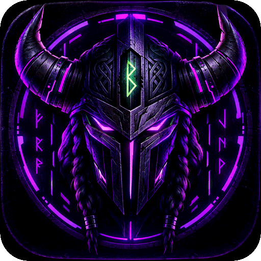
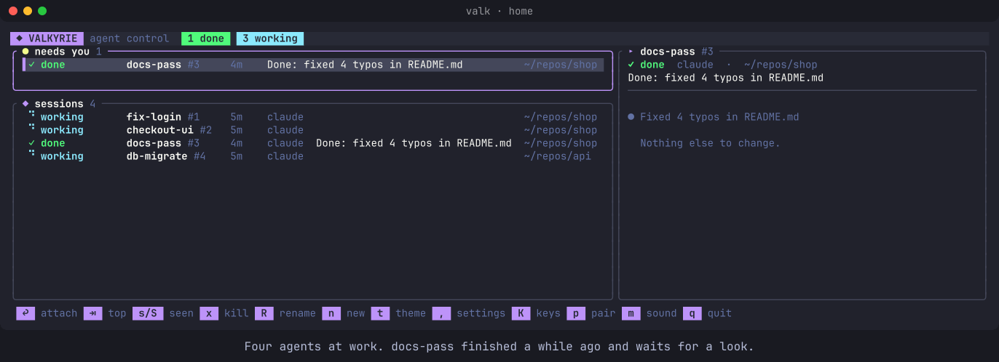
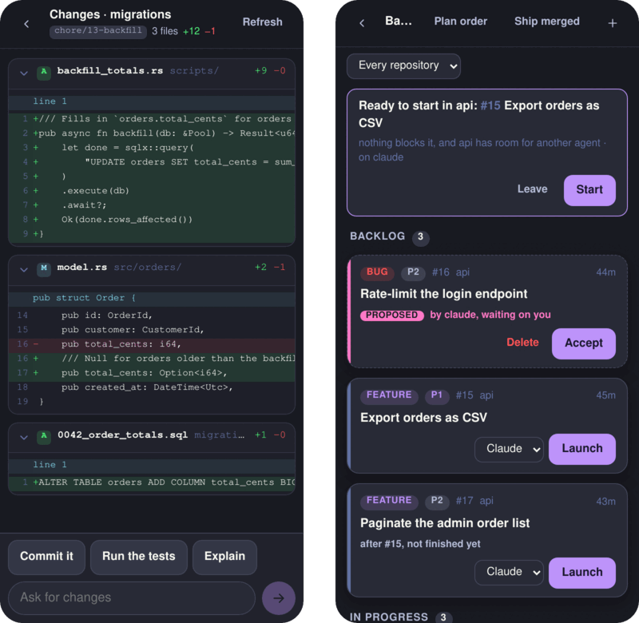
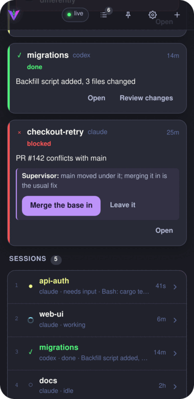
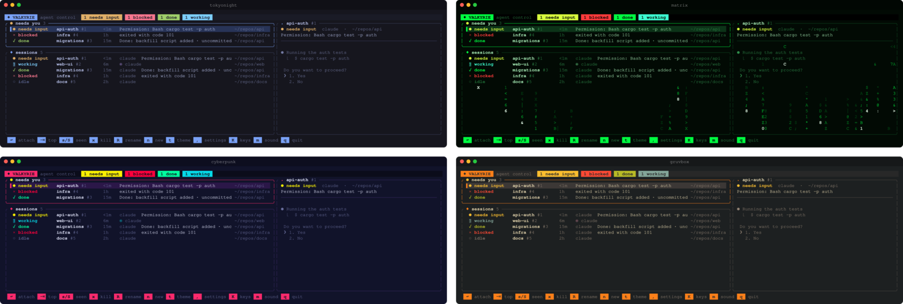

<div align="center">



# Valkyrie

**Run all your coding agents in one place, and know which one needs you next.**

[](https://github.com/bjschnell/Valkyrie/actions/workflows/ci.yml)
[](https://github.com/bjschnell/Valkyrie/releases)
[](LICENSE)
[](https://www.rust-lang.org)


[Why](#why-valkyrie) · [What it does](#what-it-does) · [Phone app](#the-phone-app) · [FAQ](#faq) · [Quick start](#quick-start) · [Docs](docs/README.md)

<br>



<br>

```sh
curl -fsSL https://raw.githubusercontent.com/bjschnell/Valkyrie/main/install-release.sh | bash
```

<sub>Linux, macOS and WSL2. Windows and the rest are in the [quick start](#quick-start).</sub>

</div>

---

## Why Valkyrie

When you run five coding agents at once, most of your time goes into checking
on them. One has been waiting on a permission prompt for twenty minutes while
you looked at another tab. You tell a third, for the third time today, that the
project uses pnpm. A pull request went red an hour after its agent stopped, and
nobody noticed.

Valkyrie runs Claude Code, Codex and your shells side by side and keeps track
of them for you. It puts whoever is waiting at the top of one queue, on your
terminal and on your phone. It gives every agent in a repo the rules you've
already taught one of them. When a pull request breaks after its agent is done,
it brings the session back with the fix ready to send.

## What it does

### Shows you who's waiting

Agents that need you go to the top of the queue with the question they asked,
and a chime tells you when that changes. `Alt-n` jumps to the next one from
anywhere and returns you to where you were when the queue is empty.

### Teaches every agent what you taught one

You can write a rule once ("never pkill by pattern") and every agent in the
repo starts with it. Most rules you never have to write. When you correct an
agent, or say the same thing in three sessions, Valkyrie drafts the rule and
asks you to accept it. Agents can propose rules but can't accept them.

### Carries work past the agent's last message

Agents often stop at "the changes are ready" with nothing committed. A ship
policy sends a Claude agent on to run your checks and open the pull request.
After that, Valkyrie watches the PR. If CI fails or main moves underneath it,
the session comes back flagged, with one step offered: fix CI, merge main in,
or rerun a known flake. A step you take every time can become automatic.

Merging stays with you. No agent merges a pull request or pushes to your
default branch until you say yes at your own keyboard.

### Turns a bug report into a running agent

Write a bug down with `Alt-a`, or from your phone with a screenshot. When
you're ready, one tap starts an agent on it in its own git worktree. The card
moves across the board as the agent works and closes when the PR merges.

### Keeps agents out of each other's way

Each agent hears which files the others in the repo are editing, so two of
them don't rewrite the same file without knowing. With `-w`, each one gets its
own worktree.

## The phone app

`valk web` is a full app for your phone, not a terminal squeezed onto a small
screen. The inbox shows prompts with their answers as buttons, and each agent's
work reads as a chat, with the live terminal one tab away.

<p align="center">
  
</p>

When an agent finishes, open its diff and send "Commit it" or "Run the tests"
with one tap. The backlog board lives here too, including the supervisor's
offer to start whatever is ready next.

<p align="center">
  
</p>



If a pull request breaks while you're out, its session shows up in the inbox
with the reason and the step the supervisor suggests. In this case main moved
and the PR conflicts, so it offers **Merge the base in**. One tap sends the
agent to merge main, resolve the conflicts, run the checks and push.

You can also start new agents in any folder, dictate messages, attach
screenshots, and get a push notification when an agent needs you. Pairing a
phone takes one QR code.

<br clear="right">

## Built with itself

Valkyrie is developed in Valkyrie. Of this repository's 112 merged pull
requests, 76 came from items on its own backlog, and 35 active project
decisions steer the agents that work on it (November 2026).

## Under the hood

- Valkyrie is one static Rust binary with the web app built in, so there's
  nothing else to install.
- It doesn't use tmux. It hosts the terminals itself on alacritty's VT engine,
  which lets it read agent state reliably and redraw a session for a phone.
- A background daemon owns every terminal. Sessions keep running when you close
  the TUI or lose SSH, and Claude and Codex conversations resume after a reboot.
- `valk upgrade` hands the running daemon to the new binary, and your sessions
  keep going (Windows restarts them).
- The daemon never listens on a network. You choose how your phone reaches it,
  and Valkyrie sets up Tailscale for you if you have it.
- Eleven themes, five of them with digital rain, plus splits and full mouse
  support.



## FAQ

**Which agents does it work with?**
Claude Code and Codex get full state tracking and their prompts on your phone.
Learning from your corrections is on for Claude Code by default. Any other
program runs as a regular terminal tab.

**Does it change my repo or my CLAUDE.md?**
No. Rules live in Valkyrie's own store and reach agents through hooks. You can
export them to the repo if you want them in git.

**Does my code go anywhere?**
Only where your agents already send it. The small model that drafts rules is
Haiku on your own Claude login, with no tools, and one setting turns it off.

**Will an agent ever merge or push to main by itself?**
No. That always waits for you.

**Does it run on Windows?**
Yes, natively, as well as on macOS, Linux and WSL2.

**What does it cost?**
Nothing. It's open source under the AGPL-3.0.

## Quick start

```sh
# Linux, WSL2, macOS (Apple silicon)
curl -fsSL https://raw.githubusercontent.com/bjschnell/Valkyrie/main/install-release.sh | bash
```

```powershell
# Windows 10 1809+ x64, in PowerShell
irm https://raw.githubusercontent.com/bjschnell/Valkyrie/main/install.ps1 | iex
```

Run `valk`, press `n` for a shell, and start `claude` or `codex`. Start a few
more. `Alt-n` takes you to whichever one needs you. To add your phone, run
`valk setup web` and scan the code.

## Docs

[Install](docs/install.md) · [Using Valkyrie](docs/usage.md) ·
[Keys](docs/keys.md) · [Settings](docs/settings.md) ·
[Phone app](docs/phone.md) · [Project decisions](docs/decisions.md) ·
[Policies](docs/policies.md) · [Supervisor](docs/supervisor.md) ·
[Backlog](docs/backlog.md) · [Contributing](docs/contributing.md)

## License

[AGPL-3.0](LICENSE). You can use, change and share it freely. If you run a
modified version as a service for others, you have to offer them its source.

<div align="center">
<br>
<sub>If Valkyrie catches a prompt you would have missed, a ⭐ helps other people find it.</sub>
</div>
