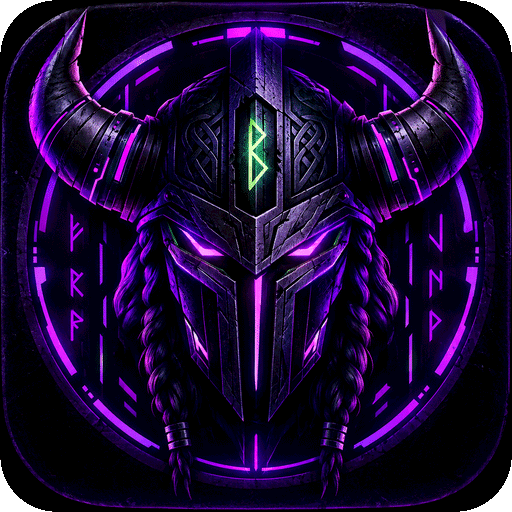
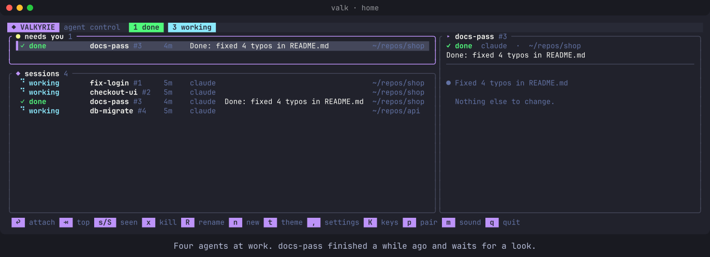
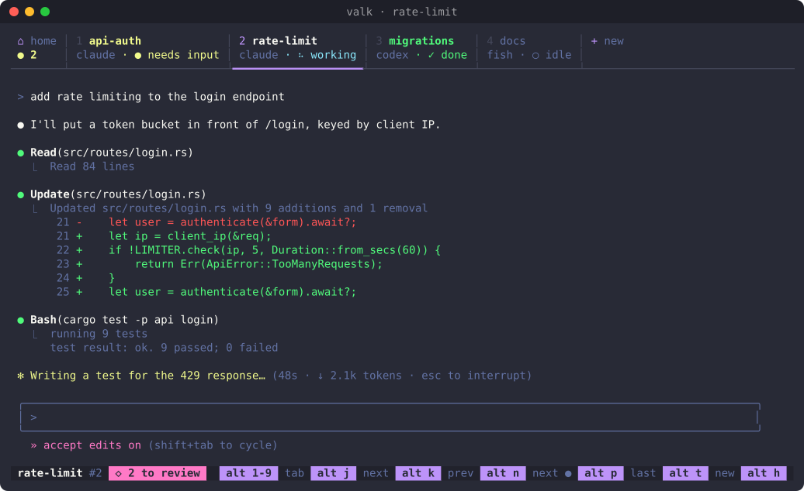
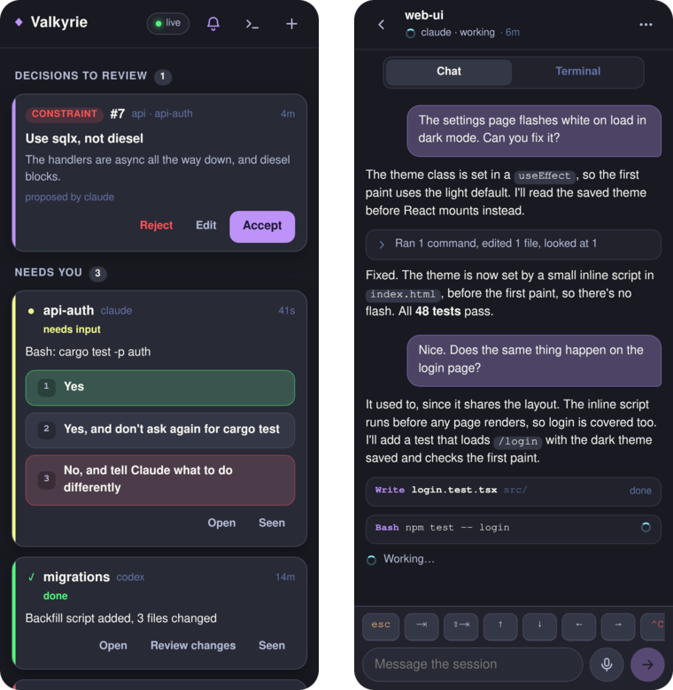
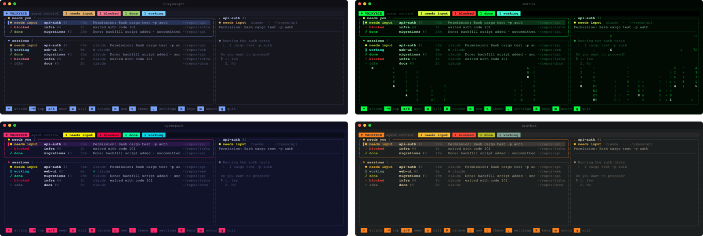

<div align="center">



# Valkyrie

**Run all your coding agents in one place, and know which one needs you next.**

[](https://github.com/bjschnell/Valkyrie/actions/workflows/ci.yml)
[](https://github.com/bjschnell/Valkyrie/releases)
[](LICENSE)
[](https://www.rust-lang.org)


[Quick start](#quick-start) · [Screenshots](#screenshots) · [Usage](#usage) · [Phone app](#from-your-phone) · [Project decisions](#project-decisions) · [Install guide](docs/install.md)

<br>



</div>

---

## What is this?

Running many agents at once results in a game of hide and seek trying to find the agent that needs input from you to continue. Balancing many agents turns into a juggling act making sure you don't leave any hanging. Valkyrie solves this by making sure your attention is automatically directed to where it is needed most. No more searching.

Valkyrie runs every session under one background daemon. Its home screen is an
inbox ranked by who needs you (`needs input`, then `blocked`, then `done`). When
something new needs you, it chimes and tells you what the agent asked. 

Sessions keep running after you close the TUI, and `valk web` serves a phone app
over your tailnet, so you can answer a prompt with one tap.

## Quick start

**1. Install.** Pick the line for your system.

```sh
# Linux, WSL2, macOS (Apple silicon): one static binary, installed to ~/.local/bin
curl -fsSL https://raw.githubusercontent.com/bjschnell/Valkyrie/main/install-release.sh | bash
```

```powershell
# Windows x64 (Windows 10 version 1809 or newer), in PowerShell
irm https://raw.githubusercontent.com/bjschnell/Valkyrie/main/install.ps1 | iex
```

**2. Start.** Enter the app easily from any terminal using the `valk` command.
The home screen lets you quickly spawn a new AI agent session by pressing 'n'.
Manage your fleet of agents easily from either the home screen, or the session lists UI

```sh
valk                       # open the home screen any time
```

Claude Code needs no setup, since Valkyrie adds its hooks per session. If you use
Codex, run `valk setup codex` once.

<details>
<summary><b>Updating, Windows notes, and building from source</b></summary>

<br>

**Updating.** Run `valk upgrade`. It downloads the latest release, swaps it in,
and hands the running daemon to it, so every session keeps running (Windows
restarts them). The home screen says when a newer release is out. From v0.0.1,
rerun the install line once to get `valk upgrade`.

**Windows.** The PowerShell installer puts a native `valk` on your user PATH and
adds a Windows Terminal profile. Use agents installed on Windows and your Windows
repos. WSL2 is still available through `install-wsl.ps1`.

**From source.** This needs a C toolchain. `install.sh` installs Rust with rustup
if you don't have it.

```sh
git clone https://github.com/bjschnell/Valkyrie.git ~/repos/valkyrie
cd ~/repos/valkyrie && ./install.sh
```

[docs/install.md](docs/install.md) covers each platform in detail.

</details>

## Highlights

- **An attention queue, not a grid of terminals.** The home screen lists the
  sessions waiting on you. Jump easily to whichever AI agent needs you with `alt-n`.
  Inside a session, tab mode (`^\`) peeks at the tab under its cursor,
  and decisions waiting for review show in the bar.
- **Sessions that outlive the TUI.** The daemon owns every terminal. Close the TUI,
  SSH in from somewhere else, and every session is still running. Upgrades on Unix
  keep running sessions; Windows upgrades restart them and resume agent
  conversations. After a reboot, Claude and Codex conversations resume.
- **Tabs and splits.** Every session is a tab. Put the tabs on top, left or right,
  drawn as underlines, folders or cards. Split a tab into panes in any direction.
- **Control your agents remotely.** `valk web` serves a PWA over your tailnet with an inbox, one-tap
  answers to prompts, a chat view built from the agent's transcript, a review of
  what an agent changed, new sessions, dictation, sending files and screenshots to
  an agent, and notifications.
- **Project based Memory.** Tell Valkyrie a rule once ("we use pnpm"), and every agent
  in the repo starts with it.
- **No tmux.** Valkyrie hosts the terminals itself (with alacritty's VT engine), so
  it can read state reliably and redraw the screen for a phone.

## Screenshots

<sub>Made-up sessions, rendered from the app's own test fixtures.</sub>

**Inside a session.** Every session is a tab that shows its program and state. The
bar at the bottom has the keys, and the number of decisions waiting for you.



**On your phone.** Answer a permission prompt with one tap, accept a decision an
agent proposed, or follow an agent's work as a chat.

<p align="center">
  
</p>

**Themes.** Dracula, Cyberpunk, Blackout, Catppuccin, Nord, Gruvbox and Tokyo
Night, plus Matrix and Violet, whose home screens have digital rain.



## Usage

```sh
valk                       # open the TUI
valk new -a -- claude      # start Claude Code in a new session and attach
valk new -- codex          # start Codex in the background
valk new -w --name "fix login" -a -- claude   # in its own git worktree and branch
valk ls                    # list sessions, with their state
valk setup codex           # once, if you use Codex: adds Valkyrie's hooks
```

### One worktree per agent

`-w`/`--worktree [BRANCH]` starts a session in a new git worktree, so agents in the
same repo never edit one checkout. The worktree goes beside the main checkout as
`<repo>-<branch>` (for example `~/repos/app-fix-login`).

- The branch is new, made from the current `HEAD`, unless BRANCH already exists.
  Without BRANCH, it's named after `--name`.
- Uncommitted changes and ignored files (`node_modules`, `.env`) don't come along.
- Every worktree shares the repo's decisions. The phone's New session screen has
  the same option.
- Valkyrie doesn't remove worktrees. Once the work is merged, run
  `git worktree remove <path>`.

### Keys

Three keys get you started: `↩` on the home screen attaches to a session, `^]`
takes you back home, and `Alt-n` steps through each session that needs you.

<details>
<summary><b>All default keys, remapping, and the mouse</b></summary>

<br>

| Where | Key | Does |
|---|---|---|
| Home | `↩` / `⇥` | attach to the selected session / the top of the queue |
| | `n` · `x` · `R` | new shell · kill · rename |
| | `s` / `S` | mark seen / all seen |
| | `,` · `t` · `m` · `K` | settings · theme · sound · keys |
| Anywhere | `Alt-1`–`Alt-9` · `Alt-h` | jump to a tab · home |
| | `Alt-j` / `Alt-k` · `Alt-p` | next / previous tab · the tab you were last on |
| | `Alt-n` | each session that needs you, then back where you started |
| | `Alt-t` · `Alt-w` · `Alt-o` | new shell tab · close tab · next pane |
| Attached | `^\` | tab mode (below) |
| | `^]` | back home |
| Tab mode | `h`/`l` (or `j`/`k`) · `H`/`L` | move between tabs · reorder |
| | `1`–`9` · `0` · `⇥` | jump to a tab · home · next one needing you |
| | `s` / `v` · `o` | split · move between panes |
| | `n` · `r` · `x` · `,` | new tab · rename · close · settings |
| | `m` | minimal tabs: one row each; at the side, a rail of icons that opens under the mouse |
| | `d` | decisions to review, over the session (`a`/`d` accept/reject) |

**Remapping.** Press `K` on the home screen (or in the settings panel), then `↩`
and the new key. `⌫` clears a key, `r` puts back its default, and `R` twice puts
back every default. A key can be Alt and almost any key, or Ctrl and a letter,
apart from the ones programs need (Ctrl-C, Ctrl-D, Ctrl-Z, …). `^]` always goes
home, so a remap can't lock you out. Changes are kept in `settings.toml` as
`keys.<action> = "<key>"`.

**On a Mac,** set your terminal to send Option as Meta for the Alt keys
(Terminal.app: Settings → Profiles → Keyboard; iTerm2: Profiles → Keys → Left
Option key → Esc+). Tab mode works without it.

**The mouse.** Click a tab, drag it to reorder, right-click it for a menu,
right-click a pane to split it, and drag a divider to resize. Click a link in a
session to open it in your browser (Ctrl+click over a program that takes the mouse,
such as vim). Over SSH, the link is copied to your clipboard instead.

</details>

### Settings

Press `,` to open the settings panel. You can change:

- the theme: `dracula`, `cyberpunk`, `blackout`, `catppuccin`, `nord`, `gruvbox`,
  `tokyonight`, `matrix`, `violet` or `valkyrie`
- whether sessions take the theme's colors (`theme`) or your terminal's
  (`terminal`)
- the tab style (`underline`, `folder`, `cards`), side (`top`, `left`, `right`)
  and detail (`full`, or `minimal`: one row per tab; at the side, a rail of numbers
  and state icons that opens over the session under the mouse or in tab mode)
- sound, and project context

With `theme` colors, a session's background, default text and 16 ANSI colors come
from the theme. Colors a program picks exactly (256-color or RGB) stay as it drew
them.

<details>
<summary><b>Where settings are kept</b></summary>

<br>

Settings are kept in `~/.config/valkyrie/settings.toml`
(`%APPDATA%\Valkyrie\settings.toml` on Windows), which you can also edit by hand.
`VALK_THEME`, `VALK_SESSION_COLORS`, `VALK_TABS`, `VALK_TAB_SIDE`, `VALK_TAB_DETAIL`, `VALK_SOUND` and
`VALK_PROJECT_CONTEXT` override it for one run.

</details>

### From your phone

```sh
valk setup web    # runs valk web as a service, behind tailscale serve
```

This needs HTTPS certificates turned on in the Tailscale admin console. Scan the
QR code it prints. The code works once, for ten minutes; the phone stays paired
until you revoke it.

To add another device, such as the app installed on your Home Screen (on iPhone
it can't open the QR link) or a laptop, tap **Add a device** in an app that's
already paired, or press `p` in `valk`. Type the short code it shows into the
new device's pairing screen.

```sh
valk web pair             # print another QR code and short code
valk web open             # open it in this computer's browser, paired
valk web devices          # list paired devices
valk web revoke <name>    # unpair one
```

The web server listens only on localhost, and the daemon never listens on a
network.

### Project decisions

Tell Valkyrie something once, and every agent in the repo starts with it.

```sh
valk decide -k constraint "Never pkill by pattern" "It killed tool shells; kill exact pids."
valk decisions            # this repo's decisions (--all: retired ones too)
valk decisions preview    # what an agent gets at session start
valk decisions export     # copy them into .valkyrie/decisions/ for git
valk handoff 3 --to codex -a   # start codex on session 3's work, with a resume of it
valk decisions health     # what waits on you; decisions that may be out of date
claude mcp add valkyrie -- valk mcp   # optional: let agents search decisions
```

How it works:

1. **Agents get the rules.** Claude sessions receive the active decisions when they
   start, after `/clear`, and after compaction. Nothing is written to CLAUDE.md.
2. **Agents propose, you decide.** Agents are told they can propose decisions with
   `valk decide`, but a proposal applies only after you accept it: on the phone, on
   the TUI home screen, or with `valk decisions accept <id>`. An agent can't accept
   its own.
3. **Corrections become proposals.** When you correct an agent ("no, we use pnpm"),
   a small model (Haiku, on your own Claude login, with no tools) reads that
   exchange and proposes the rule in it. This is on for Claude sessions by default;
   `valk decisions auto all|off` changes it.
4. **Agents know about each other.** With each prompt, an agent also hears what the
   other agents in the same repo are doing: what you asked them, the files they're
   editing, and any file you've both touched. Two agents don't end up silently
   editing the same file.

<details>
<summary><b>Hooks, turning it off, and where decisions are kept</b></summary>

<br>

This also works for a `claude` you type into a Valkyrie shell. `valk` keeps its
hooks in Claude Code's own settings (`~/.claude/settings.json`). They do nothing
outside a Valkyrie session, and they give a typed `claude` the same state tracking,
correction reading and sibling notes as a session Valkyrie started.

To switch context off, use the **Context** row in the settings (`,`), set
`context = off` in `settings.toml`, or set `VALK_PROJECT_CONTEXT=off`.
`valk setup claude --remove` takes the hooks out of Claude's settings, and
`valk setup claude` puts them back.

Every worktree of a repo shares its decisions, which are kept in
`~/.local/state/valkyrie/context` (ADR-0007 in [docs/adr](docs/adr)).

</details>

## How it's built

Valkyrie is a Rust workspace:

| Crate | Role |
|---|---|
| `valkyrie` | the `valk` binary and CLI |
| `valkyrie-daemon` | PTY host, session manager, socket server, upgrade handoff |
| `valkyrie-term` | per-session screen model on `alacritty_terminal` |
| `valkyrie-agents` | agent adapters, state tracking, queue ranking (pure logic) |
| `valkyrie-proto` | wire protocol: messages, framing, async client |
| `valkyrie-context` | project decisions: store, project roots, the injected block |
| `valkyrie-tui` | the terminal client (ratatui) |
| `valkyrie-web` | serves the web app and bridges it to the daemon |

The web app (`web/`, React + Vite) is built into `web/dist`, which is committed and
embedded in the binary, so building `valk` needs no Node.

## Contributing

Issues and pull requests are welcome. To run the tests:

```sh
cargo test --workspace             # Rust tests
cd web && npm ci && npm test       # web tests; `npm run build` refreshes web/dist
```

[DESIGN.md](DESIGN.md) is the design and its history, and [docs/adr](docs/adr)
holds the architecture decisions. Pushing a `v*` tag builds the release binaries
(`.github/workflows/release.yml`).

## License

[AGPL-3.0](LICENSE). You can use, change and share Valkyrie freely. If you run a
modified version as a service for others, you must offer them its source.

<div align="center">
<br>
<sub>If Valkyrie catches a prompt you would have missed, a ⭐ helps other people find it.</sub>
</div>
