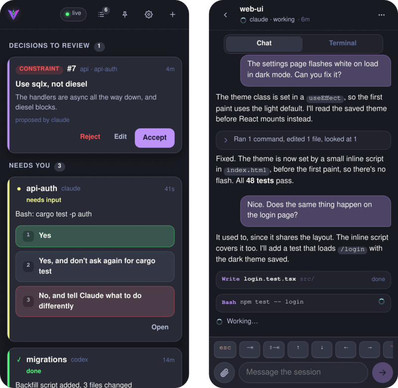

# The phone app

`valk web` serves Valkyrie as an app for your phone or any browser. Instead of a
terminal squeezed onto a small screen, you get an app made for keeping up with
agents:

- The inbox shows who needs you, with a prompt's answers as buttons. One tap
  answers it, and **Allow all** clears a run of plain yes prompts.
- Each agent's work reads as a chat, built from its transcript, with the live
  terminal a tab away.
- When an agent finishes, **Review changes** shows its diff, and one tap asks it
  to commit, run the tests or explain.
- Start Claude Code, Codex or a shell in any folder, dictate messages, and send
  files and screenshots to an agent.
- Push notifications tell you when an agent needs you, finishes or stops while
  you're away.

<p align="center">
  
</p>

```sh
valk setup web    # keep valk web running as a service, and pair with a QR code
```

`valk web` listens only on localhost, and the daemon never listens on a network.
How your devices reach it is up to you: Tailscale, a reverse proxy or a tunnel.
If Tailscale is installed, `valk setup web` puts it behind `tailscale serve`;
otherwise pass `--url` with the address your devices open. The app installs and
sends notifications only over HTTPS.

Scan the QR code it prints. The code works once, for ten minutes; the device
stays paired until you revoke it.

To add another device, such as the app installed on your Home Screen (on iPhone
it can't open the QR link) or a laptop, open **Settings → Add a device** (the gear)
in an app that's already paired, or press `p` in `valk`. Type the short code it shows into the
new device's pairing screen.

```sh
valk web pair             # print another QR code and short code
valk web open             # open it in this computer's browser, paired
valk web devices          # list paired devices
valk web revoke <name>    # unpair one
```

On a computer, the session's terminal takes your keyboard: click it and every
key goes to the program, the session is sized to the window, and the wheel
scrolls back through its history. Ctrl+C is the program's, so copy and paste are
Ctrl+Shift+C and Ctrl+Shift+V (Cmd+C and Cmd+V on a Mac). Click anywhere else,
or press Ctrl+Shift+Enter, to get the keyboard back.

On a wide screen the session list stays beside the open session. The Alt keys
from the terminal app move between sessions: `Alt-j` and `Alt-k` step through
them, `Alt-1` to `Alt-9` jump to one, `Alt-n` goes to whoever needs you, `Alt-p`
to the one you were last on and `Alt-h` home. They work while you type in a
terminal too.
